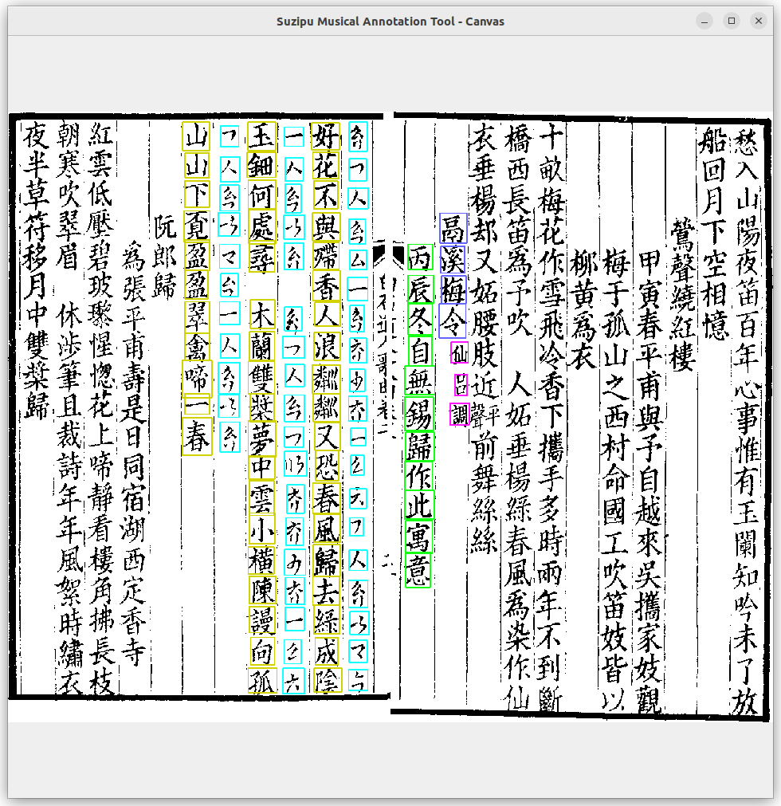
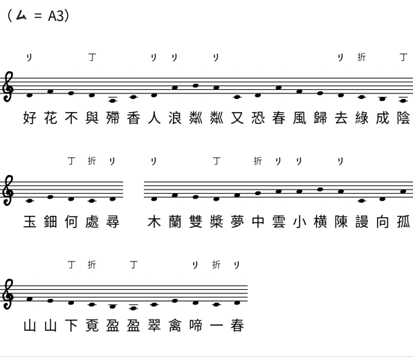
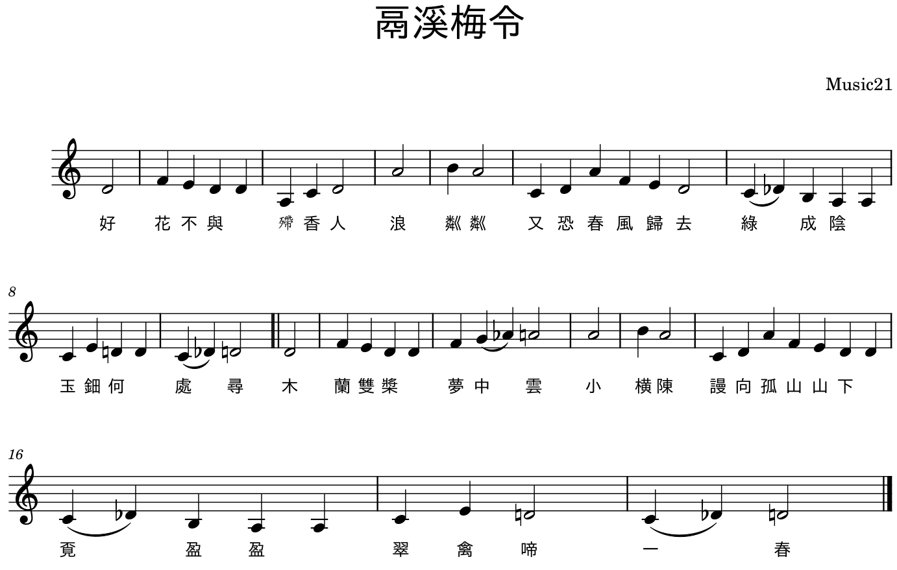

## SuziAI project

Welcome to the SuziAI project, a collection of repositories targeting digitization and AI methods for historical Chinese
notations in *Jiang Kui*'s 姜夔 poetry collection *Baishidaoren Gequ* 白石道人歌曲 (*Songs of the Whitestone Daoist*) from 1202.
This collection contains 109 poems in total, and 27 of them are endowed with three different kinds of musical notations:

*Suzipu* 俗字譜 notation (literal translation: *common character notation*), also called *banzipu* 半字谱 notation (literal
translation: half character notation) is a notation which was predominantly used in Song dynasty in China (960–1279).
In addition, the notation is still used in the actively performed music tradition of *Xi'an Guyue* 西安鼓樂. 17 pieces in
*Baishidaoren Gequ* feature this notation, and it is therefore the largest historical source of this notation.

*Lülüpu* 律呂譜 notation (mainly used for ritual music). This notation appears in 10 pieces in *Baishidaoren Gequ*.

*Jianzipu* 減字譜 notation (literal translation: *reduced character notation*) is a tablature for the seven-stringed zither
*guqin* 古琴. In this tablature, individual playing techniques are expressed in the space of one square, similar to how 
Chinese characters consist of multiple components. This is in contrast to the earlier *wenzipu* 文字譜 (*Chinese character notation*)
notation, where playing instructions were given in the form of Chinese sentences. In *Baishidaoren Gequ*, the piece
*Guyuan* 古怨 (*Ancient Lament*) uses this notation, and is the earliest surviving example of *jianzipu* we know of today.

### Goal

The goal of SuziAI is to promote the easy accessibility of cultural heritage (in the form of historical musical notations)
through digitization. This is achieved by conducting research about the notations using digitization and methods of artificial
intelligence (AI) in several different aspects:

1. Creating digital machine-readable representations of the notations.
2. Toolboxes for creating digital representations of music scores using such notations, e.g., via annotation or notation editor software.
3. Development of OMR algorithms for said notations, for more efficient and less tiresome digitizations.

We hope that this digitization project will lead to musicologists being able to apply computer-assisted analyses in the future, as well
as increased interest in these notations by the international community of researchers. Also the development of educational software
for historical Chinese musical notations is an interesting future field of research.

### Subprojects

The subprojects currently associated with SuziAI are:
1. [gui-tools](https://github.com/SuziAI/gui-tools): The digital representation of the three musical notations in *Baishidaoren Gequ* and the annotation
   tool for creating databases suitable for the development of OMR techniques, as well as a notation editor for the creation of purely symbolic digital
   representations of scores using these notations.
2. [KuiSCIMA](https://github.com/SuziAI/KuiSCIMA): A digital machine-readable corpus of both purely symbolic and OMR-oriented representations of all 109
   pieces from *Baishidaoren Gequ*, featuring the three notations *suzipu*, *lülüpu*, and *jianzipu*.
3. [SuziOMR](https://github.com/SuziAI/SuziOMR): The development of deep learning algorithms for optical music recognition (OMR) of *suzipu* and *lülüpu* notations.
4. [HumanAnnotationBaselineStudy](https://github.com/SuziAI/HumanAnnotationBaselineStudy): Due to the *suzipu* notation's ambiguity, it is difficult to assess an OMR model's performance. For this, a user study was performed to compare the OMR model's accuracy and time against the performance of human users. This repo contains the code for the GUI in a Django application.
5. [SuziGEN](https://github.com/SuziAI/SuziGEN): Stylistic generation of musical notation for *ci* 詞 poetry in the style of the 17 *suzipu* pieces in *Baishidaoren Gequ*. *Ci* was originally sung, but became a purely literary genre of poetry later. What could the (now lost) melodies have sounded like?
   

